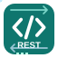

## Introduction

I'm an **Electronic and Communication Engineering student at Can Tho University** with a strong interest in **Linux**, **Embedded Systems**, **PCB Design**, **AI Agent Development**, and **IoT**.

My experience includes:

* **PCB design with Altium and Proteus**
* Embedded programming on **STM32, ESP32, Raspberry Pi, MSP430, FPGA**
* Cloud integration using **PostgreSQL/Supabase**
* Building practical systems by combining **hardware, embedded software, and computer vision**

---

### Technologies &amp; Tools

28 authentic logos · 28 distinct function-inspired SVG animations

 

<table align="center">
  <tr>
    <td align="center" width="96">
      
       C
    </td>
    <td align="center" width="96">
      
       C++
    </td>
    <td align="center" width="96">
      
       C#
    </td>
    <td align="center" width="96">
      
       Go
    </td>
    <td align="center" width="96">
      
       Python
    </td>
    <td align="center" width="96">
      
       Rust
    </td>
    <td align="center" width="96">
      
       Kotlin
    </td>
    <td align="center" width="96">
      
       Next.js
    </td>
    <td align="center" width="96">
      
       Node.js
    </td>
  </tr>
  <tr>
    <td align="center" width="96">
      
       Java
    </td>
    <td align="center" width="96">
      
       TypeScript
    </td>
    <td align="center" width="96">
      
       React Native
    </td>
    <td align="center" width="96">
      
       HTML
    </td>
    <td align="center" width="96">
      
       CSS
    </td>
    <td align="center" width="96">
      
       JavaScript
    </td>
    <td align="center" width="96">
      
       Vue
    </td>
    <td align="center" width="96">
      
       TensorFlow
    </td>
    <td colspan="1"></td> 
  </tr>
  <tr>
    <td align="center" width="96">
      
       Docker
    </td>
    <td align="center" width="96">
      
       MySQL
    </td>
    <td align="center" width="96">
      
       PostgreSQL
    </td>
    <td align="center" width="96">
      
       MongoDB
    </td>
    <td align="center" width="96">
      
       GraphQL
    </td>
    <td align="center" width="96">
      
       SQLite
    </td>
    <td colspan="3"></td> 
  </tr>
  <tr>
    <td align="center" width="96">
      
       Git
    </td>
    <td align="center" width="96">
      
       Linux
    </td>
    <td align="center" width="96">
      
       Postman
    </td>
    <td align="center" width="96">
      
       FastAPI
    </td>
    <td align="center" width="96">
      
       REST API
    </td>
    <td colspan="4"></td> 
  </tr>
</table>

<a href="./assets/animated/README.md">Explore the animation design</a> · <a href="./assets/animated/preview.html">Interactive gallery source (run locally)</a>

GitHub README images display subtle ambient SVG motion; direct hover/active animation is available in the standalone interactive gallery.

